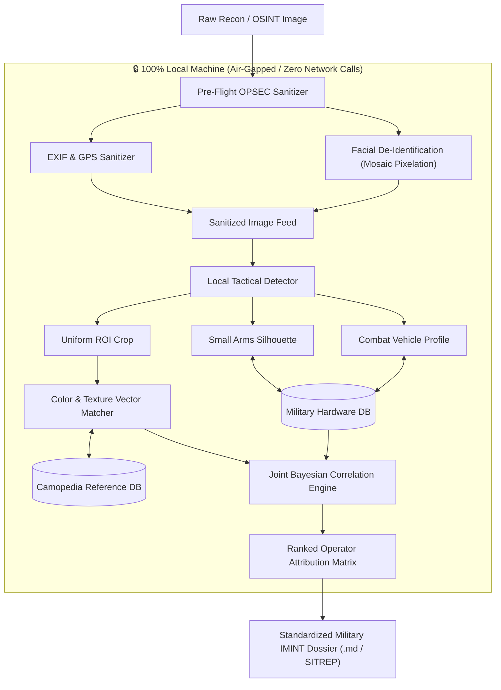

# 🛡️ AegisIMINT: Privacy-Preserving & OPSEC-Compliant Military IMINT Analyzer

[](https://opensource.org/licenses/MIT)
[](https://www.python.org/)
[](#-opsec--privacy-architecture)
[](#-features)
[](#-quick-start)

> **AegisIMINT** is an open-source, 100% air-gapped, operational-security-first (OPSEC) military imagery intelligence (IMINT) analyzer. It automatically classifies military camouflage patterns, detects small arms, armored vehicles, and tactical equipment, and computes joint attribution probabilities for operator nations, military branches, and conflict theaters—**with zero outbound network traffic and zero biometric leakage.**

---

## 🎯 The Problem & Our OPSEC-First Solution

In traditional intelligence and OSINT analysis, uploading field imagery to commercial cloud APIs poses severe **operational security (OPSEC)** risks:
- ❌ **Biometric Leaks:** Faces of friendly, neutral, or reconnaissance personnel exposed to external cloud servers.
- ❌ **Geolocation Leaks:** Embedded EXIF, GPS coordinates, camera serials, and timestamps exposed.
- ❌ **Network Exposure:** Unencrypted or logged outbound API requests violate classified or air-gapped network protocols.

### 🛡️ How AegisIMINT Solves This (100% Air-Gapped IMINT):
1. **Pre-Flight Metadata Purge:** All EXIF metadata, GPS coordinates, and camera fingerprints are stripped *locally* before any inspection.
2. **Automated Facial Redaction:** Human faces and biometrics are obfuscated using local tactical mosaic pixelation or censor bars.
3. **Local Computer Vision:** Uniform fabrics, firearm profiles, and gear are segmented entirely on your local machine.
4. **Offline Camopedia Vector Matching:** Camouflage classification is computed locally using mathematical color-space and texture signatures.
5. **Zero Outbound Data:** The entire application operates without an internet connection. No API keys, no cloud dependencies, and zero data leaves your hardware.

---

## 🏗️ System Architecture



---

## 🚀 Key Features

* **🎨 Camouflage Pattern Recognition:** Matches uniform textures against standard global patterns (MultiCam, EMR / Digital Flora, MARPAT, Flecktarn, CADPAT, M90 Splinter, TSK Digital, Type 07, IDF Olive Drab, Partizan-M SS-Autumn, All-Black Tactical, etc.).
* **⚔️ Cross-Asset Hardware Correlation:** Cross-references small arms (AK-74M, AKM, M4A1, MPT-76, HK416), armored vehicles (BTR-82A, BMP-2, Bradley, Kirpi, Toyota Technical), and ballistic gear (FAST vs. 6B47).
* **📍 Theater & Unit Attribution:** Computes joint probability distributions indicating most likely operator nations, specialized brigades, and active conflict theaters.
* **🔒 100% Air-Gapped & Offline:** Operates in isolated, disconnected, and classified lab environments. No third-party API keys required.
* **📊 Tactical HUD Interface:** Dark-mode Streamlit dashboard with tactical bracket overlays and extracted color palette strips.
* **📄 Standardized SITREP Reports:** One-click exportable Military Intelligence Assessment Reports in Markdown.

---

## 📁 Repository Structure

```
.
├── app.py                     # Streamlit Tactical Intelligence Dashboard (Offline)
├── cli_analyze.py             # Command-line assessment utility
├── test_pipeline.py           # Integration test suite
├── generate_samples.py        # Synthetic test swatch generator
├── requirements.txt           # Project dependencies
├── .env.example               # Local configuration template
├── LICENSE                    # MIT License with research disclaimer
├── data/
│   └── sample_images/         # Non-sensitive synthetic reference samples
└── src/
    ├── opsec/                 # Privacy & OPSEC sanitization engine
    │   ├── metadata_sanitizer.py  # EXIF / GPS purging
    │   ├── face_redactor.py       # Biometric masking & pixelation
    │   └── anonymizer.py          # Pre-flight coordinator
    ├── vision/                # Local Computer Vision & ROI extraction
    │   ├── detector.py            # Local tactical entity detector
    │   └── patch_extractor.py     # Swatch isolate & normalizer
    ├── database/              # Knowledge bases & vector index
    │   ├── camouflage_db.py       # Camopedia reference catalog
    │   ├── military_hardware_db.py# Small arms & armor database
    │   └── vector_matcher.py      # Color space & texture distance matcher
    ├── reasoning/             # Intelligence correlation
    │   ├── correlation_engine.py  # Bayesian operator attribution matrix
    │   └── intelligence_reporter.py # Standardized SITREP dossier compiler
    └── utils/
        └── visualizer.py          # Tactical HUD overlays & swatches
```

---

## ⚡ Quick Start

### 1. Clone Repository
```bash
git clone https://github.com/NGlory7/Privacy-Preserving-OPSEC-Compliant-Military-IMINT-Analyzer.git
cd Privacy-Preserving-OPSEC-Compliant-Military-IMINT-Analyzer
```

### 2. Install Dependencies
```bash
pip install -r requirements.txt
```

### 3. Launch the Tactical Dashboard
```bash
streamlit run app.py
```

### 4. Or Run via CLI
```bash
python cli_analyze.py path/to/image.jpg
```

---

## 🧪 Running Automated Tests

Verify end-to-end functionality offline with the included test suite:
```bash
python test_pipeline.py
```

---

## ⚖️ Ethical Use & Disclaimer

```
DISCLAIMER:
This tool is developed strictly for academic research, open-source verification,
defensive intelligence (OSINT), and educational purposes. It analyzes visual data
points locally to assist researchers, journalists, and defense analysts.
It is NOT designed or authorized for offensive targeting, combat operations,
or unlawful surveillance.
```

---

## 🤝 Contributing
Contributions from the OSINT, Computer Vision, and Defense Analytics community are welcome! Feel free to submit issues or pull requests to expand the camouflage pattern database or hardware catalog.
