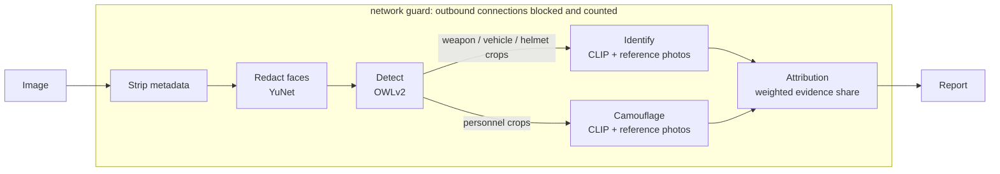

# 🛡️ AegisIMINT — offline military imagery analysis

[](https://github.com/NGlory7/Privacy-Preserving-OPSEC-Compliant-Military-IMINT-Analyzer/actions/workflows/test.yml)
[](LICENSE)
[](https://www.python.org/)

AegisIMINT looks at a photo and tells you what military equipment and uniforms it can
see, entirely on your own machine:

1. **Sanitizes** the image: strips EXIF/GPS/camera metadata and pixelates faces (YuNet face detector).
2. **Detects** personnel, rifles, machine guns, rocket launchers, tanks, armored vehicles,
   pickup trucks and helmets with **OWLv2**, an open-vocabulary detector.
3. **Identifies** each crop against a catalog (AK-74M vs M4A1, T-72B3 vs Bradley, MultiCam vs EMR…)
   with **CLIP ViT-L/14**, zero-shot or with your own reference photos.
4. **Ranks candidate operator countries** from what was actually identified, and says
   *inconclusive* when the evidence is thin.

Everything runs inside a **network guard** that blocks and counts any outbound connection
attempt, so "offline" is enforced, not just promised. Each report shows the count (expected: 0).

> **How accurate is it?** See [EVALUATION.md](EVALUATION.md): detection recall, false alarms and
> top-1/top-3 identification accuracy on a labelled Wikimedia Commons set, next to chance level.
> Short version (150 images): finding *that* there is a rifle or an armored vehicle works well
> (94–96 % found, no weapon/vehicle false alarms on everyday negatives at the default thresholds).
> Telling *which* one it is is harder: rifles 52 % top-1 (57 % with reference photos) vs 11 % chance,
> vehicles 78 % vs 17 %, camouflage patterns 46 % (56 % with reference photos) vs 7 %.
> Treat identifications as hints to verify by eye.

## What changed in v2

Version 1 did not run any detection model. It drew boxes at fixed positions
(e.g. "uniform" was always the middle of the image at 91 % confidence) and inferred the weapon
from the camouflage guess. v2 replaces that with real models, real scores and a measured
evaluation. The synthetic sample swatches were removed because they were not representative.

## Quick start

```bash
git clone https://github.com/NGlory7/Privacy-Preserving-OPSEC-Compliant-Military-IMINT-Analyzer.git
cd Privacy-Preserving-OPSEC-Compliant-Military-IMINT-Analyzer
python -m venv .venv && .venv\Scripts\activate        # Linux/macOS: source .venv/bin/activate

# PyTorch for your hardware (pick one)
pip install torch torchvision --index-url https://download.pytorch.org/whl/cu128   # NVIDIA GPU
pip install torch torchvision --index-url https://download.pytorch.org/whl/cpu     # CPU only

pip install -r requirements.txt
python tools/download_models.py      # one time, ~2.5 GB, the only step that needs internet
```

Then, offline:

```bash
streamlit run app.py                          # web UI
python cli_analyze.py photo.jpg --json        # CLI → output/ (sanitized image, overlay, report, JSON)
python cli_analyze.py photo.jpg --weapon wpn_ak74m   # add your own identification
```

A GPU makes analysis take a couple of seconds per image; on CPU expect tens of seconds.

## How it works



- **Detection thresholds** per category are adjustable in the UI; defaults were chosen on the eval set.
- **"Unknown" is a real answer.** Every classifier has an *other / unknown* option, so it can decline
  to force a catalog match.
- **Attribution** = Σ (kind weight × model probability × catalog operator weight). The operator weights
  in `src/database/` are hand-assigned priors, not learned, and the output is a *relative evidence
  share*, not a calibrated probability. Evidence below 35 % probability is ignored and listed as such.
- **Reference photos** in `data/reference/<kind>/<catalog_id>/` make identification few-shot instead of
  zero-shot (see [data/reference/README.md](data/reference/README.md)).

## Evaluating it yourself

```bash
COMMONS_CONTACT=<your url or e-mail> python tools/build_eval_set.py   # freely licensed photos from Wikimedia Commons + COCO
python tools/evaluate.py                       # writes EVALUATION.md and eval/results.json
pytest                                         # unit tests; model tests run when weights are present
```

`eval/manifest.csv` records the licence, author and source page of every evaluation image.

## Limitations

- Labels in the eval set come from Wikimedia Commons categories and can be noisy; the set is small.
- Faces that are tiny, masked or turned away can be missed by the redactor. Check before sharing.
- Equipment and uniforms are exported, captured, copied and sold as surplus; a match is never proof
  of who is in the picture.
- The catalogs cover 9 small arms, 6 vehicles, 2 helmets and 14 camouflage patterns.

## Project layout

```
app.py / cli_analyze.py      UI and CLI (both call src/pipeline.py)
src/pipeline.py              sanitize → detect → identify → attribute, inside the network guard
src/models.py                local model registry (offline-only loading)
src/opsec/                   metadata sanitizer, face redactor, network guard
src/vision/                  OWLv2 detector, CLIP classifier, crops
src/database/                camouflage & hardware catalogs, camouflage matcher
src/reasoning/               attribution engine, report generator
tools/                       model download, eval-set builder, evaluator
tests/                       pytest suite
```

## Ethical use

For research, journalism, education and defensive OSINT. Not for targeting, surveillance of
individuals or any unlawful purpose.

## License

MIT. Model weights keep their own licences: OWLv2 (Apache-2.0), CLIP (MIT), YuNet (MIT).
